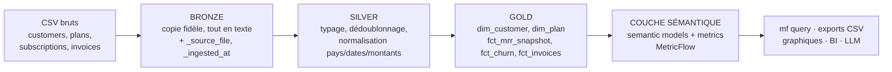
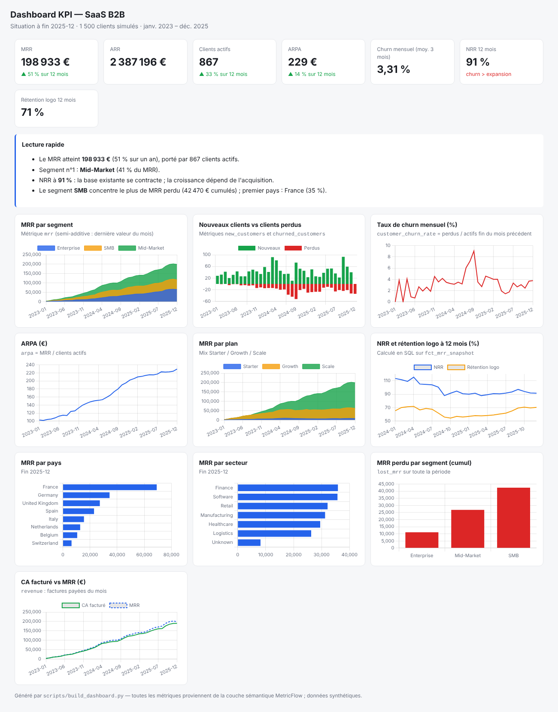
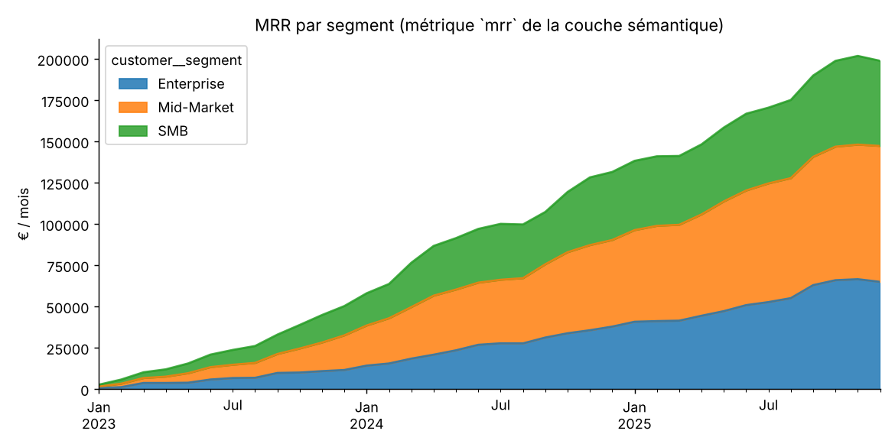
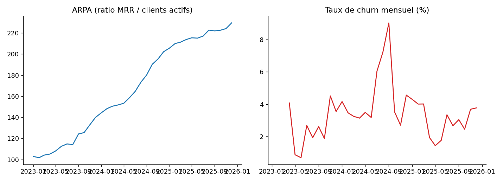

# SaaS Semantic Layer Metrics Pipeline
### Architecture médaillon + couche sémantique + dashboard KPI (dbt · MetricFlow · DuckDB)

[Voir le dashboard interactif en ligne](https://damienfernandes1996-tech.github.io/saas-semantic-layer-metrics-pipeline/dashboard.html)

Pipeline analytique complet sur des données d'abonnements SaaS (synthétiques, volontairement « sales ») :
**bronze → silver → gold → couche sémantique**. Les KPI métier (MRR, ARR, clients actifs, ARPA, churn)
sont définis **une seule fois**, en YAML, et interrogeables par n'importe quel outil (CLI, BI, notebook, LLM).

> Différence avec un simple modèle en étoile : le calcul d'un KPI n'est plus recopié dans chaque dashboard.
> Il vit dans la couche sémantique, versionné et testé.

## Architecture



| Couche | Rôle | Exemples dans le projet |
|---|---|---|
| Bronze | Ingestion brute, rien n'est perdu | `read_csv(..., all_varchar=true)` + métadonnées |
| Silver | Données fiables | 30 clients dupliqués supprimés, pays normalisés (`france`, `FR`, ` France ` → `France`), dates `JJ/MM/AAAA` et montants `49,00` convertis, 9 abonnements incohérents et 305 factures doublons/orphelines écartés |
| Gold | Modèle dimensionnel (étoile) | 2 dimensions, 3 faits dont un **snapshot mensuel de MRR** |
| Sémantique | Définition unique des KPI | 5 semantic models, 10 métriques |

## Un jeu de données qui « vit »

Le générateur n'utilise pas de probabilités constantes : il simule la dynamique d'un vrai business pour que les courbes racontent quelque chose.

| Effet simulé | Période | Ce qu'on voit dans les KPI |
|---|---|---|
| Saisonnalité des inscriptions (creux août/décembre, pics sept./janvier) | chaque année | Nouveaux clients en dents de scie |
| Campagne marketing (surtout PME) | mars-avril 2024 | Pic d'acquisition |
| Hausse de prix | juil.-sept. 2024 | Pic de churn à ~9 %, MRR à plat, NRR qui chute |
| Campagne d'upsell | oct.-nov. 2024 | Rebond de l'ARPA et du MRR |
| Arrivée d'un concurrent + tassement du marché | début 2025 | Acquisition en baisse, churn en hausse |
| Lancement du plan Scale | sept. 2023 | Le mix par plan bascule vers Scale |
| Grands comptes signés en fin de trimestre | mars/juin/sept./déc. | Marches d'escalier du MRR Enterprise |
| Churn différent par segment | permanent | SMB perd 3x plus que Enterprise |

## Ce que la couche sémantique apporte ici

- **Mesures semi-additives** : le MRR se somme entre clients mais pas dans le temps. `non_additive_dimension`
  (`window_choice: max`) fait que le MRR « annuel » est la valeur de décembre, pas la somme de 12 mois (testé).
- **Métriques ratio** : `arpa = mrr / active_customers`.
- **Métriques dérivées** : `arr = mrr * 12`.
- **Fenêtre décalée** : `customer_churn_rate = clients perdus du mois / clients actifs fin du mois précédent`
  (`offset_window: 1 month`).
- **Jointures automatiques** : `mf query --metrics mrr --group-by customer__segment` joint faits et dimensions sans SQL écrit.

Catalogue complet généré automatiquement : [`docs/metric_catalog.md`](docs/metric_catalog.md).

## Dashboard KPI

[`docs/dashboard.html`](docs/dashboard.html) : dashboard interactif autonome (un seul fichier, s'ouvre dans le navigateur).
Toutes les métriques sont lues via `mf query` : le dashboard ne recalcule aucun KPI.

- **Cartes** : MRR, ARR, clients actifs, ARPA (avec évolution sur 12 mois), churn mensuel, NRR et rétention logo à 12 mois.
- **Graphiques** : MRR par segment / plan / pays / secteur, nouveaux clients vs perdus, taux de churn, ARPA, NRR, MRR perdu par segment, CA facturé vs MRR.
- **Lecture rapide** : constats rédigés automatiquement à partir des chiffres.



Constat principal sur les données simulées : le MRR croît de +51 % sur 12 mois, mais le NRR est à 91 % (le churn dépasse les upgrades) :
la croissance vient de l'acquisition, et le segment SMB concentre le MRR perdu.

## Résultats (seed 42, 1 500 clients, 2023-2025)

| Fin d'année | MRR | ARR | Clients actifs | ARPA | Churn mensuel (déc.) |
|---|---|---|---|---|---|
| 2023 | 50 340 € | 604 080 € | 360 | 139,8 € | 3,6 % |
| 2024 | 131 599 € | 1 579 188 € | 651 | 202,1 € | 4,6 % |
| 2025 | 198 933 € | 2 387 196 € | 867 | 229,4 € | 3,8 % |




Exemple de requête :

```bash
cd dbt_project
mf query --metrics mrr,active_customers,arpa --group-by metric_time__month,customer__segment
mf query --metrics customer_churn_rate --group-by metric_time__quarter
```

## Qualité et fiabilité

- 34 tests dbt (unicité, non-nullité, valeurs acceptées, intégrité référentielle) : tous OK.
- `mf validate-configs` : configuration sémantique valide.
- 5 tests `pytest` de **réconciliation** : les résultats de la couche sémantique sont comparés à du SQL
  indépendant sur la couche gold (MRR mensuel, MRR annuel semi-additif, churn, CA facturé, ARR = 12 × MRR).

## Lancer le projet

```bash
python3 -m venv .venv && source .venv/bin/activate
pip install -r requirements.txt
make all        # données, dbt build, validate, exports, dashboard, tests, catalogue
```

Notes : DuckDB n'autorise qu'un accès à la fois au fichier `warehouse.duckdb` (ne pas garder de session ouverte pendant `make`).
Si `pip install dbt-metricflow` échoue sur la dépendance `halo` (simple spinner de la CLI), installer un stub local ou une version récente de setuptools.
Sur certaines machines, `mf` désigne Metafont (LaTeX) : utiliser `make MF=/chemin/vers/mf`.

## Structure

```
data_generation/   générateur de données brutes (seed reproductible, défauts injectés)
dbt_project/       models/{bronze,silver,gold}, macros, tests, semantic_models.yml, metrics.yml
scripts/           export des KPI via MetricFlow, dashboard HTML, graphiques, catalogue
tests/             réconciliation couche sémantique vs SQL
exports/ docs/     CSV de KPI, figures, catalogue de métriques
```

## Limites et pistes

- Données synthétiques : les niveaux de MRR/churn illustrent la méthode, pas un marché réel.
- DuckDB local ; le même projet se déploie sur Snowflake (changer l'adapter dbt).
- Pistes : consommation depuis Power BI / Dataiku, exposition du catalogue de métriques à un assistant LLM
  (les définitions sont déjà structurées), snapshots dbt pour historiser les changements de plan.

MIT · Damien Fernandes
